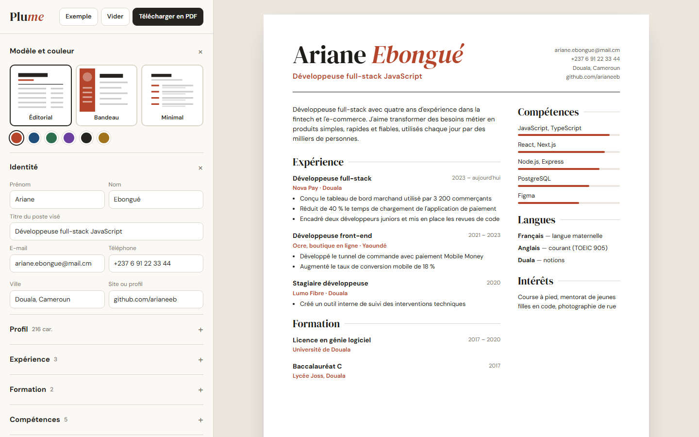
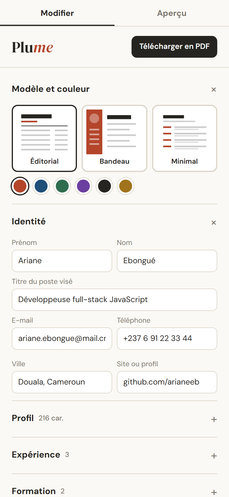

# Plume

**Créateur de CV en ligne** — Éditeur de CV qui met en page en direct : sections repliables (identité, profil, expériences, formation, compétences, langues), aperçu A4 fidèle à l'impression, trois modèles et six couleurs d'accent, score de lisibilité par les logiciels de recrutement avec conseils, sauvegarde automatique et export PDF.

**Démo en ligne : [https://lordlennyx.github.io/plume-cv/](https://lordlennyx.github.io/plume-cv/)**

Spot de présentation (30 s) : [media/spot-30s.mp4](https://lordlennyx.github.io/plume-cv/media/spot-30s.mp4)

## Ce que le projet montre

- Éditeur guidé : ajout et suppression d'expériences, de formations, de compétences avec niveau et de langues
- Aperçu A4 en temps réel, mis à l'échelle de l'écran
- Trois modèles (éditorial, bandeau latéral, minimal) et six couleurs d'accent
- Score ATS : coordonnées, longueur de l'accroche, résultats chiffrés, verbes d'action, longueur
- Sauvegarde automatique dans le navigateur, exemple et remise à zéro
- Export PDF A4 sans marges via l'impression du navigateur, mobile avec onglets Modifier et Aperçu

## Réalisation

- **Stack :** HTML, CSS, JavaScript natif
- **Typographies :** DM Serif Display, DM Sans
- **Évolutions possibles :** lettre de motivation assortie, génération de PDF côté serveur, import LinkedIn, comptes et modèles payants

| Bureau | Mobile |
|---|---|
|  |  |

---

Client et contenus fictifs, créés pour la démonstration. Conception, design et développement : **Njundiyimun Béchard** — [github.com/LordLennyx](https://github.com/LordLennyx)
